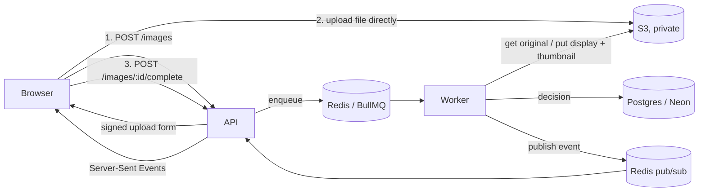

# Photo Check: backend

REST API and background worker for a photo-upload flow. Users sign up with email and password, verify
their email with a one-time code, and upload photos. Each photo is checked in the background and ends up
**accepted** or **rejected** with a reason the user can act on.

The frontend lives in a separate repository (`aragon-frontend`).

## Architecture



- **API (`src/server.ts`)**: Express 5. Never handles file bytes; the browser uploads straight to S3 with a
  presigned POST, so API instances stay small and stateless.
- **Worker (`src/worker.ts`)**: a separate process consuming a BullMQ queue. It scales on its own, and
  CPU-heavy image work never blocks API requests.
- **Postgres (Neon)** via **Sequelize** holds users, codes, sessions and image metadata.
- **Redis** carries the job queue, rate-limit counters and pub/sub for live status events.
- **S3** stores originals and derived images in a private bucket; the browser reads them through
  short-lived signed URLs.

## Request flow for one photo

1. `POST /api/v1/images` validates name, type and size, creates a row in `pending_upload` and returns a
   presigned POST. S3 enforces the exact key, the content type and a 1 B–25 MB size range.
2. The browser uploads to S3 directly (with progress).
3. `POST /api/v1/images/:id/complete` checks the object exists (`HeadObject`), moves the row to `queued`
   with a conditional update (so it's queued at most once) and enqueues a job whose id is the image id.
4. The worker sets `processing`, downloads the original and runs `analyzeImage`:
   - detects the real format from magic bytes (renamed files are caught),
   - decodes HEIC with libheif (`heic-decode`), and JPEG/PNG with sharp, checking the pixel count first,
   - writes an upright 2048 px JPEG and a 480×600 WebP thumbnail with all metadata (EXIF/GPS) removed,
   - runs the content checks below on the display copy.
5. Inside a transaction holding a per-user advisory lock, it compares the photo's perceptual hash with the
   user's accepted photos, then records `accepted` or `rejected` with reason codes.
6. Every status change is published to Redis and pushed to the user's open SSE connections.

Status machine: `pending_upload → queued → processing → accepted | rejected`, plus `failed` after retries
are exhausted.

## Validation rules

All thresholds live in [`src/config/rules.ts`](src/config/rules.ts).

| Rule | How | Default |
|---|---|---|
| Wrong format | Magic bytes via `file-type`; only JPEG, PNG, HEIC/HEIF | – |
| Too small (file) | Uploaded byte size | < 20 KB |
| Too small (resolution) | Shortest side after EXIF rotation | < 512 px |
| Blurry | Variance of the Laplacian on the face crop (large crops scaled to 256 px; small ones never upscaled) | < 60 |
| No face / face too small | YuNet face detector (OpenCV, MIT) on ONNX Runtime; longest side of the main face ÷ image's shortest side | ratio < 0.15 |
| Multiple faces | Faces ≥ 35 % of the main face's size, confidence ≥ 0.75 (ignores tiny background faces) | > 1 |
| Too similar | 64-bit difference hash; Hamming distance to the user's accepted photos, computed in SQL | ≤ 10 bits |
| Unreadable | Decode failures, truncated files, > 60 MP (decompression bombs) | – |

Calibration on sample photos: sharp portraits score 140–690, a σ=1.2 Gaussian blur drops them to 35–62,
σ≥2 to under 30. Re-encoded or resized copies of the same photo are 0–5 bits apart; unrelated photos are
27–39 bits apart.

Face detection and every other check run on our own server. No photo is sent to a third-party API.

## Data model

| Table | Purpose |
|---|---|
| `users` | email (unique, lowercased), argon2id password hash, `email_verified_at` |
| `email_otps` | HMAC of the 6-digit code, purpose (`verify_email` / `reset_password`), expiry, attempt count |
| `refresh_tokens` | SHA-256 of the token, family id, rotation link (`replaced_by_id`), revocation time |
| `images` | owner, status, reasons (JSONB), S3 keys, dimensions, perceptual hash, scores |

Indexes on `images`:
- `(user_id, status, created_at DESC, id DESC)` for listing by status with keyset pagination.
- A partial covering index `(user_id) INCLUDE (perceptual_hash) WHERE status='accepted'`, so the
  similarity check is an index-only scan over one user's accepted photos.
- A partial index on unfinished rows for the maintenance sweep.

Migrations are explicit (Umzug + Sequelize QueryInterface); the app never calls `sync()`.

## API

All routes are under `/api/v1`. Errors have the shape `{ error: { code, message, details?, requestId } }`.

**Auth**

| Method | Path | Notes |
|---|---|---|
| POST | `/auth/signup` | `{ email, password }` → 201, emails a code |
| POST | `/auth/verify-email` | `{ email, code }` → session |
| POST | `/auth/resend-otp` | `{ email, purpose }` → 202, same answer whether the account exists or not |
| POST | `/auth/login` | → session, or 403 `EMAIL_NOT_VERIFIED` (and a fresh code) |
| POST | `/auth/refresh` | uses the httpOnly cookie, rotates it |
| POST | `/auth/logout` | revokes the session |
| POST | `/auth/forgot-password` | → 202, same answer whether the account exists or not |
| POST | `/auth/reset-password` | `{ email, code, password }` → 204, signs out every device |
| GET | `/auth/me` | current user |

A session is a 15-minute JWT access token (sent as `Authorization: Bearer`) plus a 30-day refresh token in
an httpOnly cookie scoped to `/api/v1/auth`.

**Images** (all require a bearer token; another user's image id returns 404)

| Method | Path | Notes |
|---|---|---|
| POST | `/images` | `{ fileName, contentType, sizeBytes }` → 201 `{ image, upload: { url, fields } }` |
| POST | `/images/:id/complete` | → 202, idempotent |
| GET | `/images?status=accepted,rejected&limit=24&cursor=…` | keyset pagination |
| GET | `/images/summary` | counts by status plus the 6 / 10 targets |
| GET | `/images/events` | Server-Sent Events stream of `image.updated` / `image.deleted` |
| GET | `/images/:id` | one image |
| DELETE | `/images/:id` | removes the row and its S3 objects |

## Security

- **Passwords:** argon2id with OWASP parameters, using Node's built-in `crypto.argon2` (no native
  dependency). Login takes the same time for unknown emails.
- **OTPs:** 6 digits from `crypto.randomInt`, stored as an HMAC bound to user and purpose. They expire after
  10 minutes, allow at most 5 attempts, have a 60 s resend cooldown, and a new code replaces the old one.
- **Refresh tokens:** stored hashed and rotated on every use. Reusing an old token revokes the whole
  session family, with a 10 s grace for two tabs refreshing at once.
- **Rate limits (Redis-backed):**
  - per IP on all auth routes;
  - per email on routes that send or check codes (stops inbox flooding and spreading guesses across IPs);
  - per user on upload creation.
- **CSRF:**
  - Cookie-authenticated routes (`refresh`, `logout`) reject foreign `Origin` headers.
  - The cookie is `SameSite=Lax` and only sent to `/api/v1/auth`.
  - Everything else needs a bearer token, which browsers never attach on their own.
- **Files:**
  - The type is checked from the bytes, and the size is enforced by S3 itself.
  - A pixel limit applies before decoding.
  - Storage keys never contain user input.
  - The bucket blocks public access, denies non-TLS requests and is encrypted at rest.
  - Derived images have their metadata stripped.
  - Unidentifiable uploads are deleted.
- **Ownership:** every image query includes `user_id`, so another user's id behaves like a missing one.
- **Validation and headers:** zod on every input, helmet, a CORS allowlist and a 16 KB JSON body limit.
- **Secrets:** read from env and validated at boot. Logs redact auth headers, cookies, passwords and tokens.

## Reliability

- Jobs retry 3 times with exponential backoff. A permanently missing original fails immediately.
  After the last attempt the image is marked `failed` and the user is told.
- Processing is idempotent. Re-running a job for a decided image is a no-op, and a photo deleted while
  processing has its new files cleaned up.
- A maintenance job (every 15 min):
  - deletes uploads that never completed (> 1 h);
  - re-enqueues `queued` rows whose job never reached Redis.
- Graceful shutdown: the API closes SSE streams and waits for requests; the worker finishes the jobs it
  has started.

## Trade-offs and next steps

- **Similarity:**
  - A difference hash catches re-uploads, crops and burst shots cheaply and works as an index-only SQL
    scan.
  - It won't catch "same person, same room, different pose". The next step is a face or CLIP embedding
    in `pgvector` with cosine distance.
- **Blur:** Laplacian variance is fast and explainable but depends on content. Thresholds were tuned on
  sample photos; production would tune them on labelled user photos.
- **Live updates:**
  - SSE over Redis pub/sub is simple and works through proxies.
  - Events are best-effort; the client refetches on reconnect and polls as a fallback.
  - At larger scale, per-user subscriptions on each API node could move to a shared fan-out.
- **OTP email:**
  - Sent inline, so a failure shows up immediately and no plaintext code sits in a queue.
  - With higher volume it would move to a queue with a transactional provider (e.g. SES).
- **Access tokens:** they stay valid for up to 15 minutes after a password reset. Refresh tokens are
  revoked immediately.

## Folder structure

```
src/
  app.ts                 Express app: middleware, routes, error handling
  server.ts              API entry point
  worker.ts              Worker entry point
  config/                env (validated with zod) and business rules
  db/                    Sequelize instance, models, Umzug migrations
  integrations/          S3, mailer, Redis, queues
  middleware/            auth, rate limits, origin check, errors
  modules/
    auth/                routes → controller → service; OTP and token services
    images/              routes → controller → service; DTOs, events, jobs
  processing/            pure image analysis: decode, faces, sharpness, perceptual hash
  lib/                   errors, logger, crypto, password hashing, cursors
scripts/setup-bucket.ts  creates or configures the S3 bucket
models/                  YuNet face model (ONNX, MIT licence)
tests/                   unit + integration tests (Vitest, Supertest)
```

## Running locally

Requirements: Node ≥ 24.7, Postgres (or a Neon URL), Redis.

```bash
cp .env.example .env          # fill in DATABASE_URL, secrets, S3 and SMTP
npm install
npm run db:migrate
npm run setup:bucket          # once: creates the private bucket with CORS for APP_ORIGINS
npm run dev                   # API on PORT (default 4000)
npm run dev:worker            # worker, in a second terminal
```

Leave `SMTP_USER` empty in development to print codes to the log instead of emailing them.

To get a ready-to-use verified account (no email step), set `SEED_USER_EMAIL` and `SEED_USER_PASSWORD`
in `.env` and run `npm run db:seed`. It's idempotent: running it again resets that account's password.
On the server: `node --env-file=/opt/aragon/backend.env dist/db/seed.js`.

## Deployment

Production runs in AWS `ap-southeast-1`, next to the Neon database:

| Piece | Where |
|---|---|
| Frontend | AWS Amplify, built from the `aragon-frontend` repo on every push to `main` |
| `/api/*` | An Amplify rewrite proxies to the API, so the browser sees a single origin and the refresh cookie stays first-party |
| API + worker | One EC2 instance: nginx (Let's Encrypt) → Node, two systemd services (`deploy/*.service`), local Redis |
| Files | Private S3 bucket, `prod/` prefix. The instance role may only read, write and delete under `prod/`; there are no AWS keys on the server |
| Database | Neon Postgres |

Secrets live in `/opt/aragon/backend.env` (mode 600). To redeploy after pushing to `main`:

```bash
ssh ubuntu@<server> 'sudo /opt/aragon/app/deploy/deploy.sh'
```

## Tests

```bash
createdb aragon_test
NODE_ENV=test npx tsx src/db/migrate.ts up
npm test
```

86 tests cover:
- unit: image analysis on real and generated photos, password hashing, OTP rules;
- integration (real Postgres and Redis, mocked S3/mail/queue): every auth flow, image validation,
  pagination, ownership isolation, idempotent completion, and concurrent near-duplicates.

See [docs/QA_CHECKLIST.md](docs/QA_CHECKLIST.md) for manual end-to-end checks.
