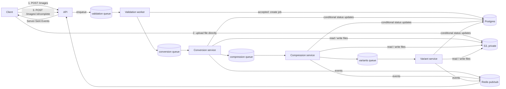

# Photo Check: backend

REST API, validation worker and media pipeline for a photo-upload flow.

- **Round 1:** users upload photos, and each one is checked in the background and ends up **accepted** or
  **rejected** with a reason they can act on.
- **Round 2:** every accepted photo then goes through a **media pipeline** of three separately scalable
  services:
  - **conversion** to one standard JPEG;
  - **compression**, with the size and ratio recorded;
  - **variant generation**, which makes thumbnail, web and full sizes with URLs and metadata.

The frontend lives in a separate repository (`aragon-frontend`).

## Architecture



Every box on the right is its own process and its own container, built from one image:

| Process | Entry point | Consumes |
|---|---|---|
| API | `src/server.ts` | HTTP |
| Validation worker | `src/worker.ts` | `image-processing` (+ maintenance) |
| Conversion service | `src/services/conversion.ts` | `pipeline-conversion` |
| Compression service | `src/services/compression.ts` | `pipeline-compression` |
| Variant service | `src/services/variants.ts` | `pipeline-variants` |

- **Stateless services.** Image bytes live in S3, progress in Postgres and jobs in Redis (BullMQ). No
  service keeps anything on disk or in memory between jobs, so any copy can take any job, and a copy
  can be added or killed at any time.
- **Image bytes never go through Redis.** A queue message is just `{ imageId, run }`. Each stage reads
  its input from S3 and writes its output back to S3.
- **Each stage hands off to the next.** When a stage finishes, it saves its output, moves the job to the
  next status with a conditional update, then queues the next stage. There is no central orchestrator
  to run or scale.
- **Predictable scaling.** Each process uses `sharp.concurrency(1)` and has the cache off, so a job uses
  at most one CPU core. A process runs `*_CONCURRENCY` jobs at once (default 2) so S3 waits overlap.
  Capacity is added with more copies:
  `docker compose up -d --scale conversion=3`.

## The media pipeline

### What happens to one photo

1. Validation accepts the photo. In the **same transaction**, it creates a `pipeline_jobs` row
   (`queued`, run 1). After commit it queues conversion. If that queueing fails, the maintenance sweep
   picks the job up later.
2. **Conversion:**
   - detects the real format from the file's bytes;
   - decodes HEIC with libheif, and JPEG/PNG with sharp, checking the pixel limit first;
   - applies EXIF rotation, flattens transparency onto white and converts to sRGB;
   - writes a quality-95 JPEG master with no metadata to `pipeline/converted.jpg`.
3. **Compression:**
   - re-encodes the master with mozjpeg at quality 80 (progressive, trellis quantisation);
   - keeps the input if re-encoding would make it bigger;
   - records `converted_bytes`, `compressed_bytes`, `compression_ratio` and `jpeg_quality`.
4. **Variants:**
   - writes `thumbnail` (256×256, cropped around the most interesting region, usually the face),
     `web` (fits in 1280×1280, never enlarged) and `full` (the compressed master);
   - upserts three `image_variants` rows and marks the job `completed`, in one transaction;
   - then removes the two intermediates.
5. Every status change is pushed to the user over the existing SSE stream (`image.updated`, now with a
   `pipeline` field).

Status flow:

```
queued → converting → compressing → generating_variants → completed
   └──────────┴─────────────┴──────────────────┴──────→ failed (stage + code + message)
```

Each status names the stage the job is waiting for or running. The `*_started_at` columns tell the two
apart, which gives queue-wait and run time per stage.

### Data model

| Table | Purpose |
|---|---|
| `pipeline_jobs` | One row per accepted image (`image_id` unique). `run` (goes up on every reprocess), `status`, `failed_stage`, `error_code`, `error_message`, source format and dimensions, `original/converted/compressed_bytes`, `compression_ratio`, `jpeg_quality`, and a timestamp for every stage start and end |
| `image_variants` | One row per image and size: `kind`, `s3_key`, `url` (the S3 address), `width`, `height`, `bytes`, `format`, `content_type`, `run`. **`UNIQUE (image_id, kind)`** |

S3 layout. Every file of a photo shares one prefix, and the names are fixed:

```
{prefix}users/{userId}/images/{imageId}/original                 upload (round 1)
                                       /display.jpg, thumbnail.webp  validation previews (round 1)
                                       /pipeline/converted.jpg   intermediate, removed when done
                                       /pipeline/compressed.jpg  intermediate, removed when done
                                       /variants/thumbnail.jpg
                                       /variants/web.jpg
                                       /variants/full.jpg
```

The bucket is private. `image_variants.url` stores the object's permanent S3 address, and the API
returns a short-lived signed URL for it.

### API

All routes are under `/api/v1` and need the user's bearer token. Another user's image returns 404.

| Method | Path | Returns |
|---|---|---|
| GET | `/images/:id/pipeline` | `status`, `run`, `error {stage, code, message}`, `sourceFormat`, dimensions, `sizes`, `compressionRatio`, `savedPercent`, `jpegQuality`, every timestamp, and `durations` (wait and run per stage, total) |
| GET | `/images/:id/variants` | `status`, `run`, `error`, `variants: [{ kind, url (signed), width, height, bytes, format, contentType, run }]` |
| POST | `/images/:id/reprocess` | 202 with the new run. 409 `PIPELINE_BUSY` while a run is in progress, 409 `NOT_ACCEPTED` for photos that weren't accepted. Also starts the first run for photos accepted before the pipeline existed |
| GET | `/ops/pipeline?since=ISO` | Operator view: per queue `waiting / active / delayed / failed / completed / workers`, jobs by status, and photos still in validation. Needs `Authorization: Bearer $OPS_TOKEN`. Off (404) when `OPS_TOKEN` is unset. Counts only, no user data |

`GET /images` and `GET /images/:id` now include `pipeline: { status, run, error }`. It's an addition
only, so the round 1 frontend keeps working.

### Failures, retries and idempotency

- **Permanent errors stop at once** with a code the user can read:
  - `SOURCE_MISSING`;
  - `UNSUPPORTED_FORMAT`;
  - `DECODE_FAILED`;
  - `INJECTED_FAILURE` (demo only).
- **Temporary errors** (`STORAGE_ERROR` for S3, `TIMEOUT` after 60 s, `PROCESSING_ERROR` for anything
  unexpected) are retried 3 times with exponential backoff.
  - The failure is saved on the job **before** BullMQ is told to stop, so a failed job is never silent.
  - Messages are written for the user; internal details go only to the logs.
- **Every write is conditional.** A stage only moves a job on `WHERE run = :run AND status = :expected`.
  So:
  - a **repeat delivery** of a finished stage does no work (it only re-queues the next stage, in case
    the first delivery crashed between saving and queueing);
  - two copies running the same stage at once both finish, but only one moves the job on;
  - a job from an **older run** is dropped as soon as it's picked up.
- **Fixed S3 keys and unique variant rows.** Running the pipeline twice overwrites the same three
  files and updates the same three rows. It can never produce duplicates.
- **Reprocess** is one conditional update: `run = run + 1` only when the job is `completed` or
  `failed`. Two requests at the same moment start one run, and the other gets 409.
- **A worker killed mid-job:** BullMQ's stalled-job check hands the job to another copy (after about
  60–90 s), and the rules above make the re-run harmless. This was tested by killing a conversion
  container during a load test: all 60 photos completed, each with exactly 3 variants.
- **A photo deleted mid-pipeline:** the job row goes with it (cascade). The stage's next conditional
  update finds nothing, and the stage deletes the files it just wrote. The delete endpoint also removes
  the pipeline and variant files.
- **Maintenance sweep** (every 15 min, in the validation worker), for jobs that haven't moved for
  10 minutes:
  - if its stage job isn't in Redis, it is queued again;
  - if BullMQ already gave up on it, it is marked failed;
  - if it is just waiting behind a long queue, it is left alone.

### Load test

`scripts/load-test/run.ts` uploads photos through the **public API**, making the same three calls a
browser makes for each one. It then follows every photo through validation and all three stages until
each has finished.

- **Accounts:** `seed-users` creates verified load-test accounts and signs their tokens. It runs where
  the secrets are (locally, or inside the API container on the server). Logging in through the API
  instead would hit the auth limit of 50 per IP per 15 min.
- **Photos:** each account uploads six portraits from `scripts/load-test/photos`: two HEIC, two JPEG
  and two PNG. All of them pass validation, and the closest pair is 19 bits apart against a limit of
  10, so none is rejected as too similar and every photo reaches the pipeline.
- **While it runs:** every 2 s it prints the uploads sent, the photos still in validation, and for each
  queue the jobs waiting, jobs active and number of workers.
- **At the end:** it prints and saves a JSON report to `load-test-results/`:
  - completed, failed and rejected counts;
  - throughput;
  - upload-to-variants and pipeline-only p50/p95/p99;
  - wait and run time per stage;
  - peak queue depth;
  - average compression;
  - every failure with its reason.

```bash
# 1. Accounts: 6 photos each, so 84 accounts for 500 photos (written to a git-ignored folder)
docker compose -f docker-compose.local.yml run --rm -T -e LOG_LEVEL=silent api \
  node dist/load-test/seed-users.js --users 84 > load-test-results/tokens.json

# 2. Run
OPS_TOKEN=... npm run load-test -- --base-url http://localhost:4090 \
  --tokens load-test-results/tokens.json --images 500 --concurrency 40

# 3. Scale the slowest stage and run again with fresh accounts
docker compose -f docker-compose.local.yml up -d --scale validation=3 --scale conversion=2

# 4. Remove the load-test accounts, their rows and their S3 files
docker compose -f docker-compose.local.yml run --rm api node dist/load-test/cleanup.js
```

**Results so far.** These were run with Docker on a laptop VM with 4 cores, sending files to S3 in
Singapore. The full reports are in [`docs/load-tests/`](docs/load-tests).

| Run | Workers (validation / conversion / compression / variants) | Photos | Completed | Throughput | Pipeline p50 / p95 | Peak queue (val / conv / comp / var) |
|---|---|---|---|---|---|---|
| 1 | 1 / 1 / 1 / 1 | 100 | 100 | 51 /min | 6.0 s / 13.8 s | 70 / 9 / 4 / 3 |
| 2 | 3 / 2 / 1 / 1 | 100 | 100 | 57 /min | 37.5 s / 51.5 s | 28 / 34 / 26 / 18 |
| 3 | 3 / 2 / 1 / 1, one conversion container **killed** mid-run | 60 | 60 | 33 /min | 18.8 s / 29.2 s | 17 / 17 / 10 / 5 |

What these runs show:
- **With one copy of each, validation (face detection) is the bottleneck.** The pipeline queues stay
  almost empty.
- **Scaling validation moves the queue downstream.** It now builds up in conversion and compression.
- **Throughput barely rises, because all seven processes share 4 cores.** Scaling out on one machine is
  capped by its CPU, so the next step is more machines.
- **In production** each service would run on its own task or pod and autoscale on queue depth, for
  example ECS or KEDA watching `bull:<queue>:wait`. The `/ops/pipeline` endpoint already exposes that
  number.

### Failure demo

```bash
# Make every compression job fail, for this one service only
ALLOW_FAULT_INJECTION=true PIPELINE_FAULT_STAGE=compression docker compose up -d --no-deps compression
npm run demo -- upload ./photo.jpg      # … failed in compression: INJECTED_FAILURE — …

# Turn it off and reprocess
docker compose up -d --no-deps compression
npm run demo -- reprocess <imageId>     # run 2: queued → converting → compressing → generating_variants → completed
```

`npm run demo` signs in with `DEMO_EMAIL`/`DEMO_PASSWORD`, uploads or reprocesses one photo, and prints
each stage as it happens from the SSE stream. It then prints the sizes, the timings and the three
variants with their URLs.

### Trade-offs and next steps

- **One job row per image** with a `run` counter is simple, and state is easy to query. There is no
  history of past runs beyond the logs; a `pipeline_runs` table would add it.
- **Stages handing off to each other** keeps every service independent, but the flow is spread across
  three processes. A BullMQ Flow or Temporal would put it in one place, at the cost of another component.
- **Fixed JPEG quality (80).** Per-image quality chosen by measuring SSIM against the master would hit
  a quality target with fewer bytes.
- **JPEG only.** WebP or AVIF variants would just be more `kind` rows and S3 keys.
- **Variants come from the compressed master**, so the web and thumbnail sizes are encoded twice.
  Building them from the converted master would avoid that small loss, but needs the bigger file.
- **Timeouts don't cancel sharp work.** The job is marked as timed out and retried, while the old
  attempt finishes in the background. Its writes are conditional, so it can't overwrite the retry.
- **Stall recovery takes about 60–90 s** (BullMQ lock duration plus stall check). A shorter lock
  recovers faster but risks false stalls on slow jobs.
- **Single Redis.** ElastiCache with Multi-AZ would remove that single point of failure.
- **Compose on one host** shows the design but scales by hand. ECS or Kubernetes with autoscaling on
  queue depth is the production version.
- **Signed S3 URLs.** CloudFront with signed cookies would cache the variants at the edge.
- **The image is about 950 MB**, mostly onnxruntime binaries for every platform. Removing the ones the
  image doesn't need would shrink it a lot.

## Validation (round 1)

### Request flow for one photo

1. `POST /api/v1/images` validates the name, type and size, creates a row in `pending_upload` and
   returns a presigned POST. S3 enforces the exact key, the content type and a 1 B–25 MB size range.
2. The browser uploads to S3 directly, with progress.
3. `POST /api/v1/images/:id/complete` checks the object exists (`HeadObject`), moves the row to `queued`
   with a conditional update (so it's queued at most once) and enqueues a job whose id is the image id.
4. The worker sets `processing`, downloads the original and runs `analyzeImage`:
   - detects the real format from magic bytes, so renamed files are caught;
   - decodes HEIC with libheif (`heic-decode`), and JPEG/PNG with sharp, checking the pixel count first;
   - writes an upright 2048 px JPEG and a 480×600 WebP thumbnail with all metadata (EXIF/GPS) removed;
   - runs the content checks below on the display copy.
5. Inside a transaction holding a per-user advisory lock, it compares the photo's perceptual hash with
   the user's accepted photos, then records `accepted` or `rejected` with reason codes. An accepted
   photo gets its pipeline job in the same transaction.

Status machine: `pending_upload → queued → processing → accepted | rejected`, plus `failed` after
retries are exhausted.

### Validation rules

All thresholds live in [`src/config/rules.ts`](src/config/rules.ts).

| Rule | How | Default |
|---|---|---|
| Wrong format | Magic bytes via `file-type`; only JPEG, PNG, HEIC/HEIF | – |
| Too small (file) | Uploaded byte size | < 20 KB |
| Too small (resolution) | Shortest side after EXIF rotation | < 512 px |
| Blurry | Variance of the Laplacian on the face crop (large crops scaled to 256 px; small ones never upscaled) | < 60 |
| No face / face too small | YuNet face detector (OpenCV, MIT) on ONNX Runtime; longest side of the main face ÷ image's shortest side | ratio < 0.15 |
| Multiple faces | Faces ≥ 35 % of the main face's size, confidence ≥ 0.75 (ignores tiny background faces) | > 1 |
| Too similar | 64-bit difference hash; Hamming distance to the user's accepted photos, computed in SQL | ≤ 10 bits |
| Unreadable | Decode failures, truncated files, > 60 MP (decompression bombs) | – |

Face detection and every other check run on our own server. No photo is sent to a third-party API.

### Round 1 tables and routes

| Table | Purpose |
|---|---|
| `users` | email (unique, lowercased), argon2id password hash, `email_verified_at` |
| `email_otps` | HMAC of the 6-digit code, purpose (`verify_email` / `reset_password`), expiry, attempt count |
| `refresh_tokens` | SHA-256 of the token, family id, rotation link (`replaced_by_id`), revocation time |
| `images` | owner, status, reasons (JSONB), S3 keys, dimensions, perceptual hash, scores |

Errors have the shape `{ error: { code, message, details?, requestId } }`.

| Method | Path | Notes |
|---|---|---|
| POST | `/auth/signup`, `/auth/verify-email`, `/auth/login`, `/auth/refresh`, `/auth/logout` | Email + password with an emailed 6-digit code; 15-min JWT access token plus a rotating 30-day refresh cookie |
| POST | `/auth/resend-otp`, `/auth/forgot-password`, `/auth/reset-password` | Same answer whether the account exists or not |
| GET | `/auth/me` | Current user |
| POST | `/images` | `{ fileName, contentType, sizeBytes }` → 201 `{ image, upload: { url, fields } }` |
| POST | `/images/:id/complete` | → 202, idempotent |
| GET | `/images?status=accepted,rejected&limit=24&cursor=…` | Keyset pagination |
| GET | `/images/summary` | Counts by status plus the 6 / 10 targets |
| GET | `/images/events` | Server-Sent Events stream of `image.updated` / `image.deleted` |
| GET / DELETE | `/images/:id` | One image / remove the row and every file of it |

## Security

- **Passwords:** argon2id with OWASP parameters (Node's built-in `crypto.argon2`). Login takes the same
  time for unknown emails.
- **OTPs:**
  - 6 digits, stored as an HMAC bound to the user and the purpose;
  - expire after 10 minutes, with at most 5 attempts;
  - 60 s cooldown before another is sent.
- **Refresh tokens:** stored hashed and rotated on every use. Reusing an old token revokes the whole
  session family.
- **Rate limits (Redis-backed):**
  - per IP on all auth routes;
  - per email on routes that send or check codes;
  - per user on upload creation and on reprocess.
- **CSRF:** the cookie routes check the `Origin` header, and everything else needs a bearer token.
- **Files:**
  - the type is checked from the bytes, and S3 enforces the size;
  - the pixel limit applies before any decode, including in conversion;
  - S3 keys contain ids only, never file names;
  - the bucket is private, TLS-only and encrypted;
  - every derived file has its metadata (EXIF/GPS) stripped.
- **Ownership:** every image, pipeline and variant query is scoped to the user, so another user's id
  behaves like a missing one.
- **Operations endpoint:**
  - off unless `OPS_TOKEN` is set;
  - the token is compared in constant time;
  - it returns counts only.
- **Fault injection:** needs `ALLOW_FAULT_INJECTION=true` as well as the stage name.
- **Load-test data:**
  - load-test tokens are signed only by a server-side script;
  - the accounts have random passwords that are never stored;
  - `cleanup` removes the accounts and their files.
- **Validation and secrets:** zod on every input, helmet, a CORS allowlist and a 16 KB JSON body limit.
  Secrets come from the environment and are validated at boot. Logs redact auth headers, cookies and
  tokens.

## Folder structure

```
src/
  app.ts, server.ts         Express app and API entry point
  worker.ts                 validation worker (+ maintenance: abandoned uploads, stuck pipeline jobs)
  services/                 conversion.ts, compression.ts, variants.ts + shared stage-worker.ts
  config/                   env (zod), validation rules, pipeline settings
  db/                       Sequelize models, Umzug migrations, seed
  integrations/             S3, Redis, BullMQ queues, mailer
  middleware/               auth, rate limits, origin check, errors
  modules/
    auth/                   routes → controller → service; OTP and token services
    images/                 upload, validation job, events
    pipeline/               stage runner, reprocess, DTOs, error codes, maintenance sweep
    ops/                    operator endpoint
  processing/               pure image code: decode, faces, sharpness, hash, convert, compress, variants
  load-test/                seed-users, cleanup (shipped in the image so they run next to the secrets)
scripts/
  load-test/run.ts, photos/ load-test runner and its photos
  demo.ts                   follow one photo live from the command line
  setup-bucket.ts           creates or configures the S3 bucket
deploy/                     deploy.sh, switch-to-docker.sh, nginx.conf
models/                     YuNet face model (ONNX, MIT licence)
tests/                      unit + integration (Vitest, Supertest)
```

## Running locally

**Everything in Docker** (its own Postgres and Redis; files go to the S3 prefix in `.env`):

```bash
cp .env.example .env    # fill in secrets, S3 and SMTP; set OPS_TOKEN for the load test
docker compose -f docker-compose.local.yml up -d --build    # API on http://localhost:4090
```

**Or as plain processes**, with Node ≥ 24.7, Postgres and Redis:

```bash
npm install
npm run db:migrate
npm run setup:bucket    # once: private bucket with CORS for APP_ORIGINS
npm run dev             # API
npm run dev:worker      # validation worker
npm run dev:conversion  # pipeline services, one terminal each
npm run dev:compression
npm run dev:variants
```

Leave `SMTP_USER` empty in development to print codes to the log instead of emailing them. For a
verified account without the email step, set `SEED_USER_EMAIL` / `SEED_USER_PASSWORD` and run
`npm run db:seed`.

## Deployment

Production runs in AWS `ap-southeast-1`, next to the Neon database:

| Piece | Where |
|---|---|
| Frontend | AWS Amplify, built from `aragon-frontend` on every push to `main` |
| `/api/*` | An Amplify rewrite proxies to the API, so the browser sees one origin |
| API, validation worker, three pipeline services | One EC2 instance, Docker Compose (`docker-compose.yml`, host networking), nginx with Let's Encrypt in front, Redis on the host |
| Files | Private S3 bucket, `prod/` prefix. The instance role can only read, write and delete under `prod/`; there are no AWS keys on the server |
| Database | Neon Postgres |

Secrets live in `/opt/aragon/backend.env` (mode 600).

- **First move from the round 1 systemd services:** `sudo /opt/aragon/app/deploy/switch-to-docker.sh`.
- **Redeploy** (pull, build, migrate, restart):

```bash
sudo CONVERSION=2 VARIANTS=2 /opt/aragon/app/deploy/deploy.sh
```

## Tests

```bash
createdb aragon_test
NODE_ENV=test npx tsx src/db/migrate.ts up
npm test
```

121 tests, on real Postgres and Redis with S3, mail and the queue mocked:
- **Unit:** image analysis, conversion (HEIC, transparency, EXIF rotation, truncated files, pixel
  limit), compression, variants, password hashing, OTP rules.
- **Integration (auth and validation):** every auth flow, validation, pagination and ownership.
- **Integration (pipeline):**
  - a full run from PNG and from HEIC, and the API responses;
  - repeat deliveries, jobs from an older run, the variant stage running twice at once;
  - reprocessing twice, two reprocess requests at the same moment;
  - permanent and temporary failures, fault injection followed by a reprocess;
  - deletion mid-pipeline, the maintenance sweep, and the ops endpoint.

See [docs/QA_CHECKLIST.md](docs/QA_CHECKLIST.md) for manual end-to-end checks.
